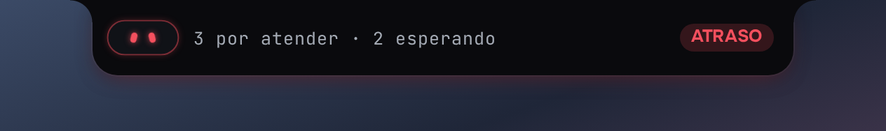
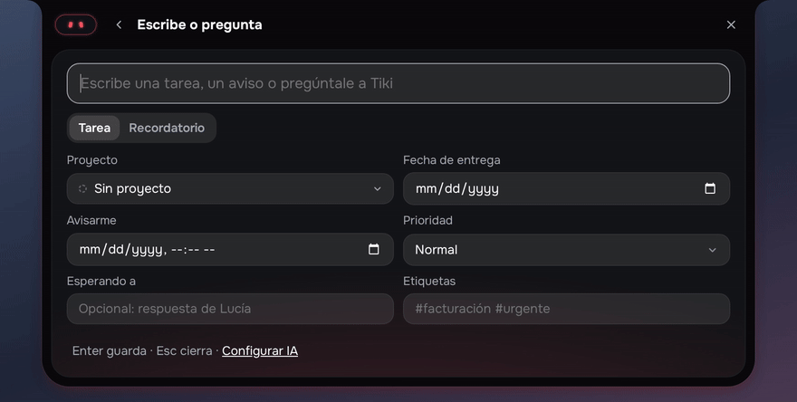
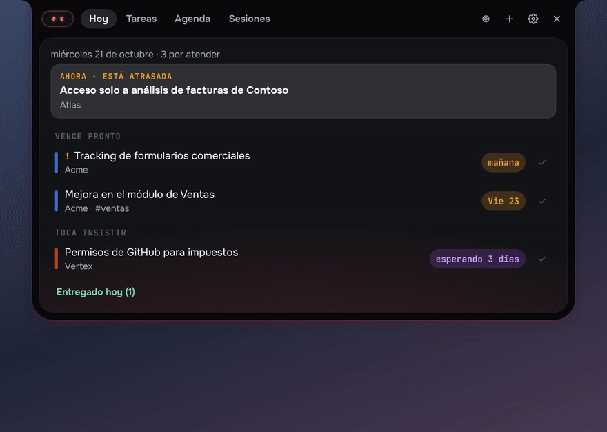
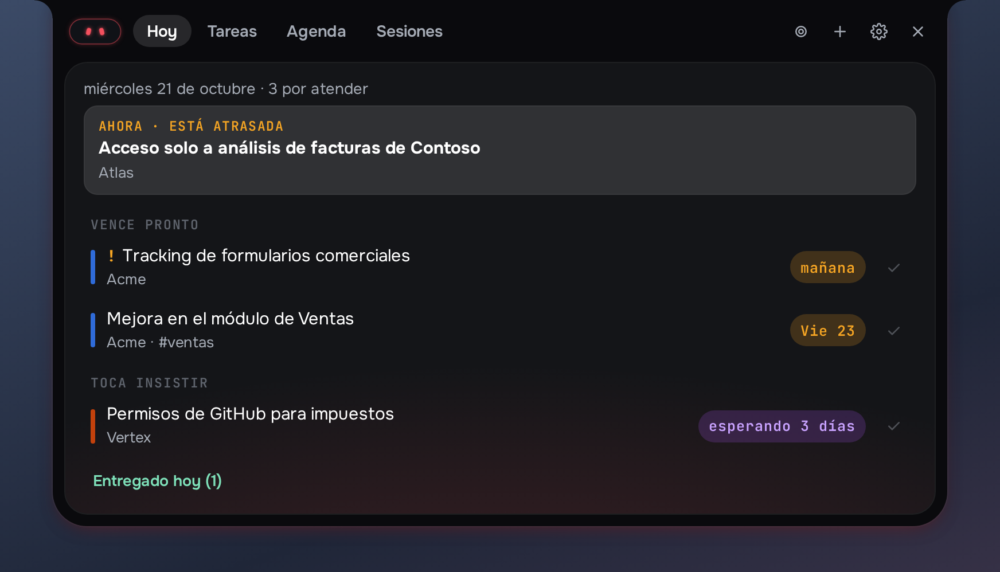
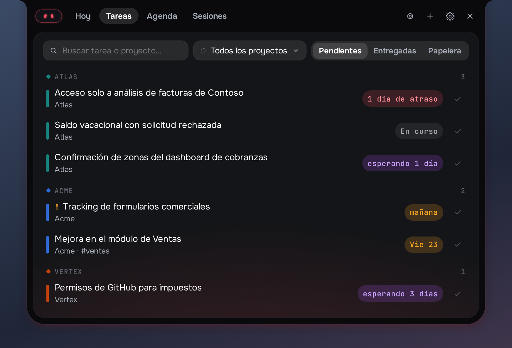
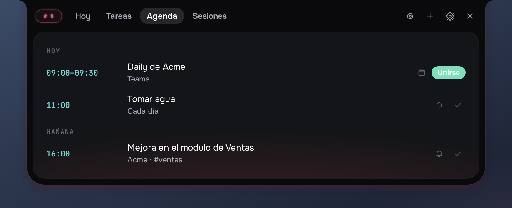
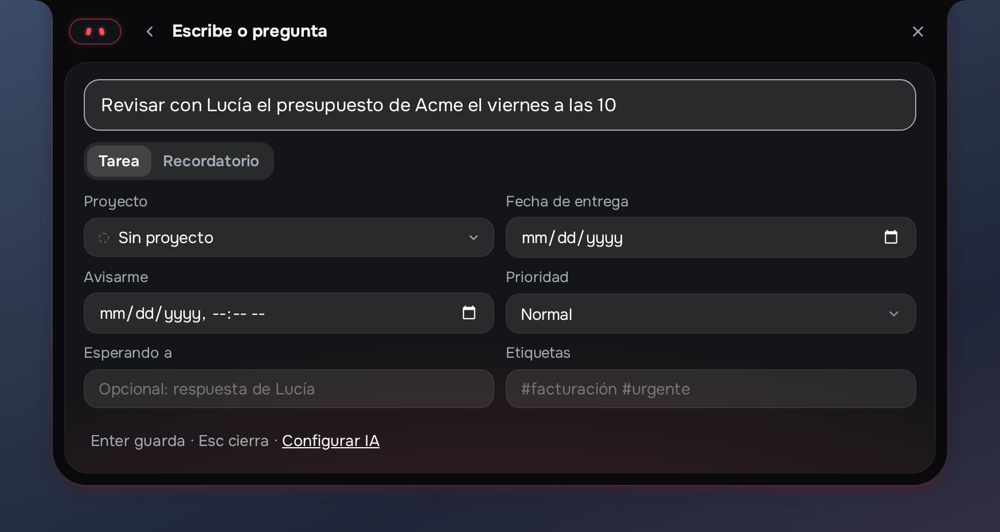

# Tiki for Windows

**Tiki is a work assistant that lives in your Windows notch.** It keeps your tasks, reminders,
meetings and recorded sessions in one place at the top of the screen, and tells you at the
right moment what needs you. Your data stays on your computer.

[Download](https://github.com/apiservicesac/tiki/releases) ·
[Website](https://tiki.apiservicesac.com/) ·
[Privacy policy](https://tiki.apiservicesac.com/privacy-policy.html) ·
[Changelog](CHANGELOG.md)


## What it does

- **Captures** a task or a reminder from one sentence, the way you would say it; an optional
  AI fills in the project, date and priority.
- **Organizes** your work by project, with tags, follow-ups, a delivered history and a trash
  you can restore from.
- **Reminds you at the right moment**: reminders, follow-ups, a morning brief, an end-of-day
  close and an alert before each meeting, with Join.
- **Reads your calendars** (Google and Microsoft 365, read-only) and shows your meetings in
  the Agenda.
- **Records sessions**: audio, or audio and video of a screen or a window, transcribed on
  your computer with Whisper, with AI notes and proposed tasks.
- **Keeps quiet when it should**: at night, during calls and in focus mode.
- With nothing pending, the notch shows how the computer is doing: CPU, memory,
  temperature and network.

Tiki's face in the notch tells the mood of your day at a glance: calm, something due, something
late, a meeting about to start.



**Capture a task from one sentence**



**Today, Tasks and Agenda**



| Today | Tasks |
| --- | --- |
|  |  |
| **Agenda** | **Capture** |
|  |  |

## Install

Download the latest `Tiki_*_x64-setup.exe` from
[Releases](https://github.com/apiservicesac/tiki/releases) and run it. The installer is ready
to use, calendar sign-in included: there is nothing to configure. Tiki updates itself: each
new version is signed and offered from its settings.

Requirements: Windows 10 or 11 (64-bit).

## Privacy

Tiki runs on your computer and keeps everything in a local database. Calendar access is
read-only, recordings are transcribed locally, and nothing is sent anywhere unless you add
your own AI key, in which case only what each feature needs goes to that provider. See the
[privacy policy](https://tiki.apiservicesac.com/privacy-policy.html).

## Build from source

Nothing is installed on the host: every toolchain runs in Docker, as your user.

```bash
make images        # build the toolchain images
make ui-install    # install the interface dependencies
make test          # Rust core and interface tests
make lint          # rustfmt, clippy (pedantic, warnings as errors), TypeScript types
make format        # format the Rust code
```

Windows builds run on GitHub Actions: the `Checks` workflow lints the desktop shell on
Windows for every push and pull request, and the `Windows installer` workflow builds the
signed installer for every `v*` tag.

The official installer comes with its own calendar sign-in. A build of your own does not:
to connect calendars, create your own OAuth clients (Google Cloud and Microsoft Entra) and
set them in the environment variables `TIKI_GOOGLE_CLIENT_ID`, `TIKI_GOOGLE_CLIENT_SECRET` and
`TIKI_MICROSOFT_CLIENT_ID`.

## Layout

```text
crates/tiki-core/        Rust core, no UI: items, activity history, alerts, agenda,
                         calendars, sessions, preferences, i18n, SQLite storage
crates/tiki-recording/   Audio and video capture, mixing, writers and local transcription
apps/desktop/            Desktop app
  src/                   TypeScript interface: the island, Tiki's face, panels, AI
  src-tauri/             Tauri 2 shell: window, tray, shortcuts, calendars, recorder
  tests/                 Interface tests (Vitest)
locales/                 es.json and en.json, shared by Rust and TypeScript
docs/                    Website (GitHub Pages) and design notes
docker/                  Toolchains: core (Rust), ui (Node)
```

## Contributing

Contributions are welcome. Read [CONTRIBUTING.md](CONTRIBUTING.md) and the
[code of conduct](CODE_OF_CONDUCT.md). To report a security problem, see
[SECURITY.md](SECURITY.md).

## License

[MIT](LICENSE) © 2026 API SERVICE SAC
